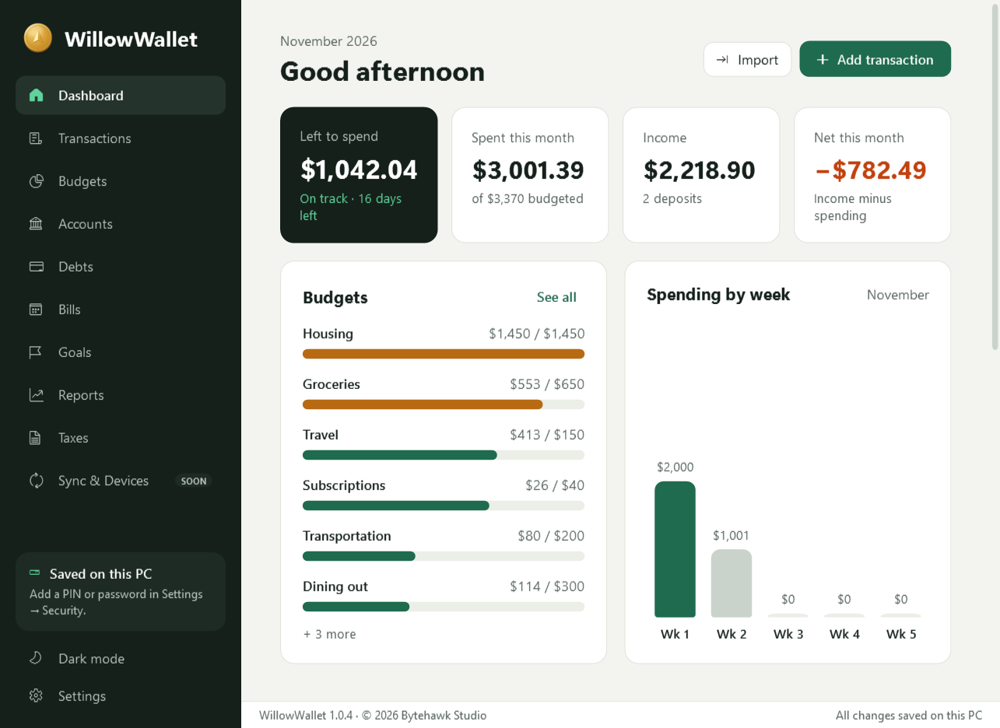

# WillowWallet




**Budgets, spending, accounts, debts, bills, goals and tax documents in one private app for Windows.**
Made by Bytehawk Studio. *(Formerly CoinPilot; the repository keeps its old name for now.)*

> **Version 1.0.4, Windows 10/11.** Everything works and is saved on your PC, with optional PIN/password encryption.
> Syncing with the WillowWallet mobile app is coming soon.

## Features

| Section | What it does |
| --- | --- |
| **Dashboard** | This month's left to spend, spent, income and net; budgets; spending by week; bills coming up; goals; recent transactions; a welcome checklist for new users. |
| **Transactions** | Spending, income and transfers between accounts; split across categories; tags; receipts; search and filters; month by month; **import bank statements (CSV, OFX, QFX)** with duplicate detection; automatic categories from your rules and history; CSV export. |
| **Budgets** | A monthly amount per category (subcategories roll up), progress bars and warnings, **rollover**, one-month amounts, **copy last month**, **templates** (50/30/20, zero-based, starter) and "left to assign". |
| **Accounts** | Checking, savings, credit cards, cash and investments with balances kept up to date from transactions; **net worth over time**; transfers; statement imports can set the balance. |
| **Debts** | Credit cards and loans with APR and minimum payments; record payments; **avalanche or snowball payoff plan** with a debt-free date and the interest you'll pay. |
| **Bills** | Bills and subscriptions on any schedule; overdue / due soon; mark paid; **reminders** (Windows notifications, optionally running in the background); **calendar view**; **finds subscriptions** you haven't added. |
| **Goals** | Savings goals with **progress rings**, **milestones**, add or take out money, **link a goal to a savings account**, and the monthly amount to stay on track. |
| **Reports** | Income vs. spending, spending by category, **net worth**, month-by-month table with savings rate, **Year in review**; export to CSV or **print / PDF**. |
| **Taxes** | A safe place for **tax documents** (W-2s, 1099s, returns, receipts) by tax year, with a checklist and drag-and-drop. |
| Sync & Devices | Coming soon: sync with the WillowWallet mobile app. |

**Settings:** light/dark/match Windows, **8 color themes** (Pine, Ocean, Lagoon, Indigo, Plum, Rose, Ember, Graphite),
**currency**, **budget month start day** (budget payday to payday), **your own categories and subcategories**, rules,
bill reminders, **PIN/password protection**, **backup and restore**, and keyboard shortcuts.

### Privacy and protection

Everything stays on your PC in `%AppData%\WillowWallet\data\`. Turn on a **PIN or password** in Settings → Security and
WillowWallet encrypts all of it (transactions, accounts, receipts and tax documents) with AES-256-GCM. The key is derived
from your PIN/password with PBKDF2-SHA256 (600,000 rounds); WillowWallet never stores the PIN/password itself. A one-time
**recovery key** opens your data if you forget it. Without either, the data can't be recovered, so keep the recovery key safe.

### Keyboard shortcuts

Ctrl+N add a transaction · Ctrl+F search · Ctrl+1…9 go to a section · Ctrl+, settings · Ctrl+L lock ·
Ctrl+Enter save in an add/edit window · Esc close a window.

## WillowWallet for Android

A Flutter app in [`mobile/`](mobile): Home (left to spend, income and net, budgets, spending by week, recent),
Transactions (by month, search, filters, swipe to delete), Budgets and Settings (light/dark, the same eight color themes,
currency). Everything is saved on the phone, using the same field names as the Windows app so the two can sync later.
Get the APK from the newest `android-v…` release. See [mobile/README.md](mobile/README.md).

## Download

Windows 10/11 (x64). Install it from the **[Bytehawk Studio Launcher](https://github.com/adamglassner/bytehawklauncher)**,
which downloads the newest release, installs it and keeps it up to date. Or get it from the
[latest release](../../releases/latest):

- **`WillowWallet-<version>-Setup.exe`**: installer with Start Menu shortcut, optional desktop shortcut and an
  uninstaller. Installs just for you by default (no administrator prompt).
- **`WillowWallet-<version>-win-x64.zip`**: portable. Unzip anywhere and run `WillowWallet.exe`.

Neither needs .NET installed. Your data is saved in `%AppData%\WillowWallet\data\` (Settings → Your data) and app settings
(theme, window size) in `%AppData%\WillowWallet\settings.json`. Uninstalling keeps them.

## Releasing a new version

Change `<Version>` in `src/CoinPilot.Desktop/CoinPilot.Desktop.csproj`, add a [CHANGELOG](CHANGELOG.md) entry and push
to `main`. GitHub Actions ([build-release.yml](.github/workflows/build-release.yml)) then, on a Windows machine:

1. builds the single-file exe, the portable zip and the installer,
2. runs the self-test (`WillowWallet.exe --self-test result.txt`) on a throwaway data folder: 400+ checks covering money
   and currencies, budget math (rollover, subcategories, mid-month budget months), transfers and splits, statement import,
   rules, account balances and net worth, payoff plans, bills and subscriptions, goals, reports, receipts and tax
   documents, backup/restore, PIN/password encryption, and every page and dialog in every color theme, light and dark,
3. silently installs the Setup .exe to a custom folder (the way the launcher does), starts it, and uninstalls it,
4. takes screenshots of every page, color theme and dialog with sample data (`WillowWallet.exe --screenshots <folder>`)
   and publishes them to the [`screenshots`](../../tree/screenshots) branch,
5. publishes GitHub Release `v<version>` with the Setup .exe and the zip.

Installed copies pick up the new version through the Bytehawk Studio Launcher. Pushes that don't change the
version, pull requests and manual runs on other branches run steps 1 to 4 only.

## Building it yourself

Requirements: Windows 10/11, the [.NET 8 SDK](https://dotnet.microsoft.com/download/dotnet/8.0), and
[Inno Setup 6](https://jrsoftware.org/isinfo.php) for the installer (`winget install JRSoftware.InnoSetup`).

- Run from source: double-click `run.bat`, run `dotnet run --project src\CoinPilot.Desktop`, or open `CoinPilot.sln`
  in Visual Studio 2022 and press F5.
- Build everything: `.\build.ps1` makes `dist\WillowWallet.exe`, `dist\WillowWallet-<version>-win-x64.zip` and
  `dist\WillowWallet-<version>-Setup.exe`. Use `-SkipInstaller` to skip Inno Setup.

Command-line options: `--page <section>` opens a page at startup (for example `--page budgets` or `--page settings`),
`--background` starts in the notification area (used when "run in the background" is on), `--self-test <file>`
runs the checks above and exits with the number of failures, and `--screenshots <folder>` saves screenshots using
sample data (never your own).

## Project layout

```
src/CoinPilot.Desktop/
  App.xaml(.cs)          startup, single instance, light/dark + color theme layers
  MainWindow.xaml(.cs)   sidebar, page host and transitions, lock screen, shortcuts, toast, window placement
  Assets/                app icon (.ico + .png)
  Themes/                Light.xaml, Dark.xaml (colors), Controls.xaml (all control styles)
  Data/                  Records, JsonStore (safe JSON files), DataStore, Preferences, Categories (+ rules),
                         Budgeting (months, rollover), Finance (balances, net worth, payoff planner, bills, goals,
                         reports, year in review, subscription finder), Importer (CSV/OFX/QFX),
                         DataLock (encryption), FileVault (receipts and tax documents)
  Models/                ModuleCatalog.cs — the sections in the sidebar
  Views/                 Dashboard, Transactions, Budgets (XAML); Accounts, Debts, Bills, Goals, Reports, Taxes,
                         Settings (code, on DataPage + PageKit); dialogs on DialogShell; Charts; Ui helpers
  Services/              money and currencies, color themes, reminders + tray icon, backup, CSV export,
                         settings, Windows theme detection, toast, self-test
installer/WillowWallet.iss  Inno Setup script (+ wizard images)
build.ps1                exe + portable zip + installer
.github/workflows/       CI: build, self-test, installer test, screenshots, release
design/mockup/           the desktop + mobile mockup this is built from
tools/                   icon and installer image generators (Python + Pillow)
```

## Roadmap

1. ~~Transactions and Budgets~~ (0.2.0)
2. ~~Accounts, Debts, Bills, Goals and Reports~~ (0.3.0)
3. ~~Everything else on the desktop: import, rules, splits, transfers, rollover, templates, reminders, taxes, protection, themes~~ (1.0.0)
4. ~~WillowWallet for Android: transactions and budgets~~ (android 0.1.0)
5. Sign-in and sync between devices, more of the desktop features on Android, iPhone

## License

Icons: [Fluent UI System Icons](https://github.com/microsoft/fluentui-system-icons) © Microsoft, MIT License
(subset built by `tools/make_icon_font.py`).


MIT — see [LICENSE](LICENSE). © 2026 Bytehawk Studio.
